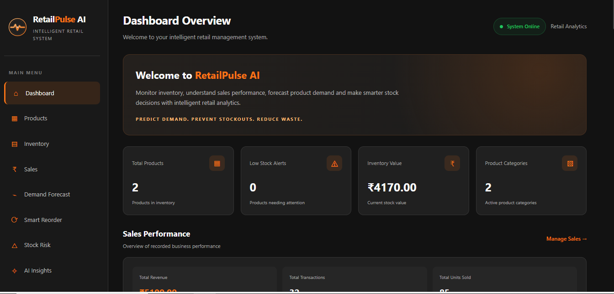

 <div align="center">


# RetailPulse AI

### Intelligent Inventory & Demand Forecasting System

**Predict Demand. Prevent Stockouts. Reduce Waste.**

A smart inventory management platform that helps retailers understand sales, forecast demand, manage stock and make better replenishment decisions.

<br/>


<br/>

**[Explore Repository](https://github.com/BudenshaS/RetailPulse-AI)**

</div>

---

## 📊 Dashboard Preview

<div align="center">

<!-- Add your dashboard screenshot at screenshots/dashboard.png -->



<sub>RetailPulse AI — Intelligent Retail Analytics Dashboard</sub>

</div>

> To display this image, create a `screenshots` folder in your project and save a dashboard screenshot as `dashboard.png`.

---

## ✨ Core Features

<table>
<tr>
<td width="50%">

### 📊 Dashboard Overview
Monitor total products, inventory value, sales performance and business activity from one dashboard.

</td>
<td width="50%">

### 📦 Inventory Management
Track product quantities, stock levels, categories and reorder thresholds.

</td>
</tr>
<tr>
<td width="50%">

### 💰 Sales Management
Record sales transactions and analyze revenue and units sold.

</td>
<td width="50%">

### 🔮 AI Demand Forecasting
Predict product demand for the next seven days using Random Forest Regression.

</td>
</tr>
<tr>
<td width="50%">

### 🧠 Smart Reorder Intelligence
Calculate reorder points and suggested quantities using forecast demand, lead time and safety stock.

</td>
<td width="50%">

### ⚠️ Stock Risk Intelligence
Identify potential stockout risks and monitor excess inventory.

</td>
</tr>
<tr>
<td colspan="2">

### ✦ AI Inventory Insights
Generate understandable, rule-based business observations from current sales, forecasting and inventory results.

</td>
</tr>
</table>

---

## 🛠️ Technology Stack

<div align="center">

| Category | Technologies |
|---|---|
| Programming Language | Python |
| Backend | Flask |
| Frontend | HTML, CSS, JavaScript |
| Database | SQLite |
| Data Processing | Pandas, NumPy |
| Machine Learning | Scikit-learn |
| Forecasting Algorithm | Random Forest Regression |
| Development Environment | PyCharm |

</div>

---

## 🧠 How the Intelligence Works

<div align="center">

**Historical Sales Data**

⬇

**Data Processing & Feature Engineering**

⬇

**Random Forest Demand Forecasting**

⬇

**Smart Reorder Calculations**

⬇

**Stockout & Overstock Risk Analysis**

⬇

**Inventory Insights & Recommendations**

</div>

### 1. Demand Forecasting
Uses historical product sales to estimate demand for the next seven days.

### 2. Smart Reorder Intelligence
Combines predicted demand, current inventory, supplier lead time and safety stock to calculate reorder points and recommended order quantities.

### 3. Stock Risk Analysis
Estimates stock coverage and identifies potential inventory shortages or excess stock.

### 4. Inventory Insights
Presents rule-based observations to help users understand their current inventory position.

---

## 📁 Project Structure

```text
RetailPulse-AI/
│
├── data/
│
├── database/
│   └── db.py
│
├── models/
│   ├── demand_forecasting.py
│   ├── smart_reorder.py
│   └── stock_risk.py
│
├── static/
│   ├── css/
│   │   └── style.css
│   ├── images/
│   │   └── retailpulse-logo.svg
│   └── js/
│
├── templates/
│   ├── dashboard.html
│   ├── inventory.html
│   ├── products.html
│   └── sales.html
│
├── tests/
│
├── screenshots/
│   └── dashboard.png
│
├── app.py
├── main.py
├── requirements.txt
├── .gitignore
└── README.md
```

---

## 🚀 Installation & Setup

### Prerequisites

- Python 3.9 or later
- Git
- A code editor such as PyCharm

### Step 1 — Clone the repository

```bash
git clone https://github.com/BudenshaS/RetailPulse-AI.git
```

### Step 2 — Navigate to the project

```bash
cd RetailPulse-AI
```

### Step 3 — Create a virtual environment

```bash
python -m venv venv
```

### Step 4 — Activate the environment (Windows)

```bash
venv\Scripts\activate
```

### Step 5 — Install dependencies

```bash
pip install -r requirements.txt
```

### Step 6 — Run the application

```bash
python app.py
```

### Step 7 — Open in your browser

```text
http://127.0.0.1:5000
```

---

## 🎯 Project Objectives

- Improve inventory visibility.
- Understand historical sales patterns.
- Estimate future product demand.
- Support smarter replenishment decisions.
- Identify potential stock shortages and excess inventory.
- Demonstrate practical applications of machine learning in retail management.

---

## 🔮 Future Enhancements

- Advanced forecasting models.
- Supplier management.
- Automated inventory reports.
- Interactive analytics and visualizations.
- Multi-product and multi-store analytics.
- Enhanced decision-support intelligence.

---

## 👨‍💻 About the Developer

<div align="center">

### Buden sha S

BCA Student | Python Developer | AI & ML Enthusiast

Interested in building practical software solutions using Python, machine learning and intelligent analytics.

<a href="https://github.com/BudenshaS">

</a>

</div>

---

<div align="center">

### RetailPulse AI

**Predict Demand. Prevent Stockouts. Reduce Waste.**

*Built to make retail inventory management smarter.*

</div>